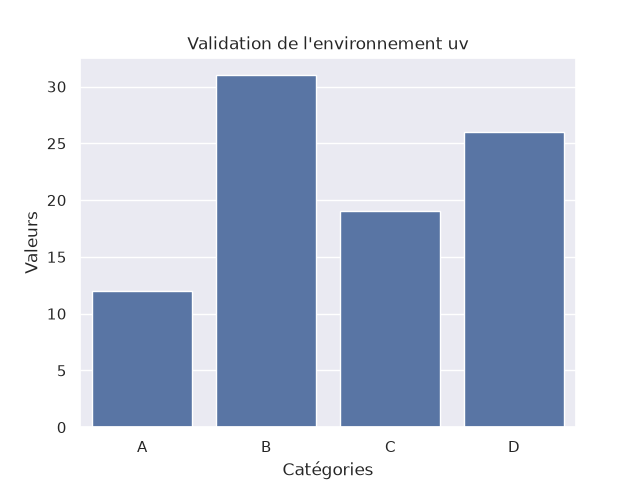

# TP0 — Python + uv, version conteneurisée

Le guide *instalation_de_python_et_uv.pdf* installe uv sur la machine, crée un `.venv` local et y enregistre un kernel Jupyter. J'ai réalisé les mêmes étapes **dans une image Docker** : le `.venv` vit dans le conteneur, et VS Code se connecte au kernel du conteneur par `localhost`. La machine hôte n'a besoin que de Docker Desktop et de VS Code.

## Correspondance avec le guide

| Étape du guide | Commande du guide | Où elle se trouve ici |
|---|---|---|
| 1. Installer uv | `irm https://astral.sh/uv/install.ps1 \| iex` | image de base `ghcr.io/astral-sh/uv:bookworm-slim` ([Dockerfile](../Dockerfile)) |
| 2. Initialiser le projet | `uv init`, `uv venv` | [`pyproject.toml`](../pyproject.toml) + `RUN uv venv` |
| 3. Activer l'environnement | `.venv\Scripts\activate` | `ENV VIRTUAL_ENV=/app/.venv PATH=/app/.venv/bin:$PATH` |
| 4. Installer les bibliothèques | `uv add ipykernel pandas matplotlib seaborn` | dépendances du `pyproject.toml`, installées par `uv sync --locked` depuis [`uv.lock`](../uv.lock) |
| 4 bis. Enregistrer le kernel | `python -m ipykernel install --name=python_uv_workspace --display-name "Python (uv-env)"` | même commande dans le Dockerfile (`--sys-prefix`) |
| 5. Configurer VS Code | extensions Python + Jupyter | identique, sur la machine hôte |
| 6. Hello World | `hello.ipynb` | [`hello.ipynb`](hello.ipynb) |
| 7. Production | `uv run app.py` | [`app.py`](app.py), lancé dans le conteneur |

Les TP suivants ont ajouté leurs bibliothèques au même `pyproject.toml` (`uv add mesa networkx`, `uv add tiktoken langchain ...`), puis l'image a été reconstruite.

## Utilisation

```bash
# Construire l'image (une seule fois, puis après chaque changement de pyproject.toml)
docker compose build

# Serveur Jupyter dans le conteneur, sur http://localhost:8888
docker compose up -d lab
```

Dans VS Code, ouvrir un notebook puis : **Select Kernel → Select Another Kernel… → Existing Jupyter Server…** → `http://localhost:8888/?token=uv-docker` → **Python (uv-env)**.

Le token est indispensable : sans lui, VS Code reçoit l'erreur `_xsrf argument missing`.

```bash
# Étape 7 du guide : exécuter app.py avec l'interpréteur du .venv du conteneur
docker compose run --rm --entrypoint python notebook TP0_installation/app.py

# Exécuter un notebook sans interface (les sorties sont écrites dans le notebook)
docker compose run --rm notebook TP0_installation/hello.ipynb

# Arrêter le serveur
docker compose down
```

## Résultat

`app.py` affiche le DataFrame et produit le graphique de validation. Le conteneur n'a pas d'écran, donc `plt.show()` n'ouvre pas de fenêtre et le graphique est aussi enregistré dans `validation_uv.png` :



Le notebook `hello.ipynb` confirme que le kernel est bien le Python 3.14 du `.venv` du conteneur (`/app/.venv/bin/python`, système Linux).

## Remarques

- Dans le PDF, la ligne `data = {'Catégories': [...], 'Valeurs':}` est tronquée : il manque la liste des valeurs. J'en ai ajouté quatre.
- Le lien d'installation du PDF (`irm https://astral.sh | iex`) est incomplet. Le bon script est `https://astral.sh/uv/install.ps1` (Windows) ou `https://astral.sh/uv/install.sh` (macOS/Linux).
