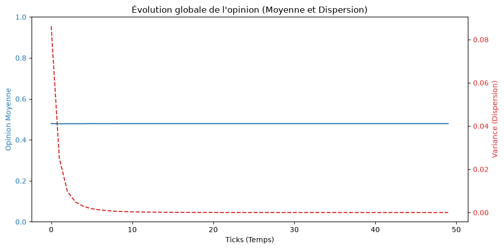
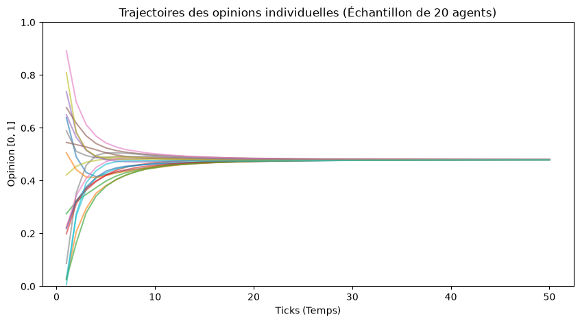
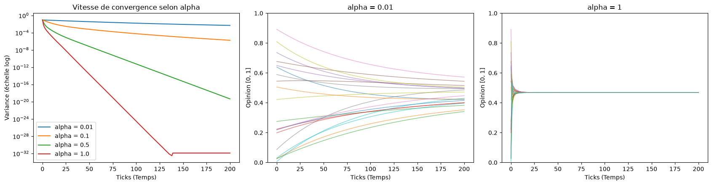
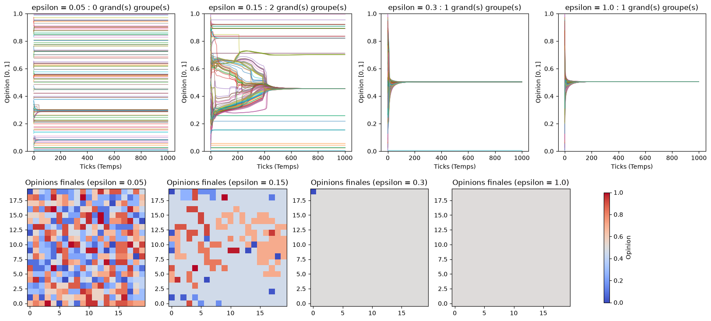
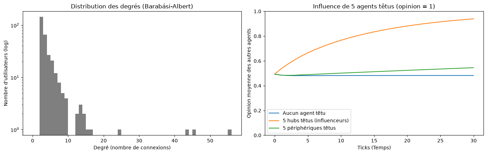

# TP2 — Simulation multi-agents avec Mesa 3 : résultats

Notebook : [TP2Mesa_Simulation_MA.ipynb](TP2Mesa_Simulation_MA.ipynb). Toutes les simulations utilisent la graine 42 : les chiffres sont reproductibles.

**Modèle :** un agent par case d'une grille torique. À chaque tick, chaque agent rapproche son opinion de la moyenne de ses 8 voisins :
$o_i^{t+1} = o_i^t + \alpha(\bar{o}_{\mathcal{N}_i}^t - o_i^t)$.

## Simulation de base (grille 10×10, α = 0.5, 50 ticks)

| Indicateur | tick 0 | tick 50 |
|---|---|---|
| Opinion moyenne | 0.480 | 0.479 |
| Variance | 0.086 | 6 × 10⁻⁸ |

La variance passe sous 10⁻⁴ dès le **tick 14** : toute la population converge vers une opinion commune, proche de la moyenne de départ, sans coordination centrale. C'est le phénomène **émergent** du modèle.

## Réponses aux questions

### Q1 — Impact de α sur la vitesse de convergence

| α | variance au tick 10 | tick où la variance passe sous 10⁻⁴ |
|---|---|---|
| 0.01 | 0.0708 | plus de 200 |
| 0.1 | 0.0144 | 87 |
| 0.5 | 0.0003 | 14 |
| 1.0 | 0.00001 | 7 |

α fixe la **vitesse**, pas l'issue : pour tout α > 0, la population finit par un consensus. Avec α proche de 0, les trajectoires restent presque plates ; avec α = 1, chaque agent copie la moyenne de ses voisins et tout se resserre en quelques ticks.

### Q2 — Pourquoi la polarisation est impossible
La nouvelle opinion est une **moyenne pondérée** $(1-\alpha)\,o_i + \alpha\,\bar{o}$, et une moyenne reste toujours entre la plus petite et la plus grande valeur. L'écart entre les opinions extrêmes ne peut donc que diminuer. On le mesure : il passe de **0.991 à 0.0009** en 50 ticks, **sans aucune hausse** d'un tick à l'autre.

### Q3 — L'émergence dans les graphiques
Aucun agent ne connaît l'opinion globale ni ne cherche le consensus. Pourtant, la variance tombe à 0 et les 20 trajectoires se rejoignent : le consensus global naît uniquement des règles locales.

### Q4 — `shuffle_do("step")`
L'ordre d'activation change à chaque tick (par exemple `[3, 68, 51, ...]` puis `[93, 13, 89, ...]`). Comme la mise à jour est asynchrone, un ordre fixe avantagerait toujours les mêmes agents et propagerait l'opinion dans un sens privilégié. L'ordre aléatoire supprime ce biais.

### Q5 — `model_reporters` et `agent_reporters`
- `model_reporters` : une ligne par tick, soit **51 lignes** (moyenne, variance, écart max-min).
- `agent_reporters` : une ligne par agent et par tick, soit **5 100 lignes** indexées par `(Step, AgentID)`.

La moyenne seule ne distingue pas un consensus à 0.5 de deux camps à 0 et 1 ; seules les trajectoires individuelles montrent la forme de la dispersion.

### Q6 — `torus=True`
L'agent en (0, 0) a **8 voisins** avec `torus=True` (la grille est refermée sur elle-même), contre **3** avec `torus=False`. Le tore supprime les effets de bord.

### Q7 — Biais de confirmation (seuil ε, grille 20×20, 1000 ticks)

| ε | groupes | grands groupes (≥ 20 agents) | plus grand groupe | agents isolés | phénomène |
|---|---|---|---|---|---|
| 1.0 | 1 | 1 | 100 % | 0 | consensus |
| 0.3 | 2 | 1 | 100 % | 1 | consensus (un extrémiste isolé) |
| 0.15 | 29 | 2 | 70 % | 17 | **polarisation** |
| 0.05 | 254 | 0 | 3 % | 180 | **fragmentation** |

Quand un agent n'écoute plus que les voisins proches de son avis, la société se divise en **chambres d'écho**, et d'autant plus que la tolérance ε est faible.

### Q8 — Réseau social avec influenceurs (`NetworkGrid`, graphe Barabási-Albert, 300 utilisateurs)
Le degré médian vaut 3 et le plus gros hub a 55 connexions. On rend 5 agents « têtus » (opinion fixée à 1) :

| 5 agents têtus | opinion moyenne des autres : tick 0 → 10 → 30 |
|---|---|
| aucun | 0.493 → 0.482 → 0.482 |
| les 5 **hubs** (degrés 16 à 55) | 0.493 → 0.766 → **0.939** |
| 5 **périphériques** (degré 2) | 0.493 → 0.501 → 0.545 |

Avec le même nombre de personnes, ce qui compte est leur **position** dans le réseau : les influenceurs entraînent presque toute la population.

## Remarque technique
Avec Mesa 3.5, `coord_iter()` renvoie `(contenu, (x, y))` et le paramètre de graine s'appelle `rng`. Le code fourni (`for _, x, y in ...`, `seed=seed`) a été corrigé.
