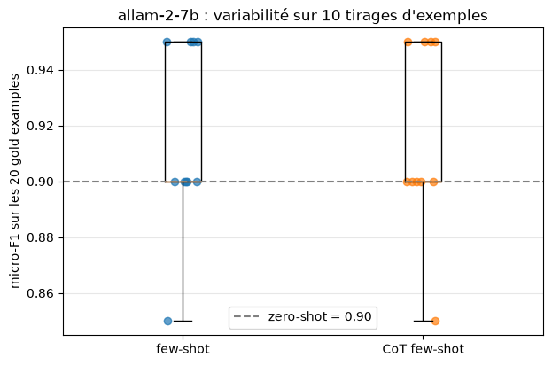

# Rapport — TP3 : Prompt Engineering, analyse de sentiment

**Module :** Système Distribué Agentique  
**Formation :** Master Intelligence Artificielle & Digital Computing (S3) — FST, Université Moulay Slimane  
**Année universitaire :** 2026–2027  
**Enseignant :** Lhoussaine Daoudi  
**Étudiant :** ELAALGI Hatim  
**Sujet :** notebook *TP3 prompt.ipynb* et support *TP3 prompt Sentimental analysis.pdf*  
**Environnement :** Python 3.14, tiktoken, LangChain, langchain-groq, scikit-learn, dans un conteneur Docker (voir le [rapport du TP0](../TP0_installation/README.md))

---

## 1. Objectifs

- Comprendre la notion de **token** et la mesurer avec `tiktoken`.
- Appeler un **LLM** depuis Python avec LangChain.
- Utiliser un LLM comme **classifieur** (sentiment positif ou négatif de critiques de films IMDB), en comparant trois techniques de prompt : **zero-shot**, **few-shot** et **Chain-of-Thought**.
- **Évaluer** ces prompts avec le micro-F1 sur des exemples de référence (*gold examples*), en tenant compte de la variabilité.

## 2. Environnement et choix techniques

| Élément | Support de l'enseignant | Ma réalisation |
|---|---|---|
| Tokens | `tiktoken`, encodage `o200k_base` | identique |
| LLM | OpenAI `gpt-4o` / `gpt-5.2`, ou Ollama `qwen3.5:cloud` | API **Groq** (gratuite) : `qwen/qwen3.8-27b`, de la même famille Qwen que le modèle Ollama proposé |
| Données | IMDB via Hugging Face | archive `dataset_imdb.zip` fournie (50 000 critiques) |
| Gold examples | 20, `random_state=42`, découpage 80 / 20 | identique |
| Few-shot | 4 exemples positifs + 4 négatifs, mélangés | identique |
| Évaluation | micro-F1, 10 répétitions | identique, sur **deux modèles** : `allam-2-7b` (7 milliards de paramètres) et `qwen/qwen3.8-27b` (27 milliards) |

**Pourquoi deux modèles ?** Dans le support, `gpt-5.2` obtient 1.0 avec les trois prompts : un modèle aussi fort ne laisse pas voir l'effet du prompt. Un petit modèle permet d'observer ce qu'apportent réellement le few-shot et le CoT.

## 3. Partie 1 — Les tokens

Le prompt de l'énoncé, « Vous êtes un expert en marketing digital. C'est quoi un digital marketer ? », donne **16 tokens** :
`Vous| êtes| un| expert| en| marketing| digital|.| C|'est| quoi| un| digital| marketer| ?|`

J'ai ajouté un test personnel : la même phrase en trois langues.

| Langue | Mots | Tokens | Découpage |
|---|---|---|---|
| anglais | 10 | **12** | `I| am| a| master's| student| in| artificial| intelligence| in| Tang|ier|.` |
| français | 9 | **13** | `... d|'int|elligence| artific|ielle| à| Tanger|.` |
| arabe | 8 | **16** | `... الذ|ك|اء| الاص|ط|نا|عي| ...` |

Le vocabulaire de `o200k_base` contient surtout des morceaux de mots anglais. À contenu égal, un texte français ou arabe consomme donc plus de tokens : il coûte plus cher et occupe plus de place dans la fenêtre de contexte.

## 4. Partie 2 — Appel d'un LLM

L'appel de l'énoncé (message *system* « Vous êtes un expert en marketing digital », message *user* « C'est quoi un digital marketer ? ») a été réalisé avec `ChatGroq(model="qwen/qwen3.8-27b", temperature=0)`. Seule la classe change par rapport à `ChatOpenAI` ou `ChatOllama`.

- L'appel a consommé **31 tokens de prompt** et **714 tokens de réponse**.
- `tiktoken` ne compte que 14 tokens pour les deux messages : Qwen utilise son propre tokeniseur et ajoute des tokens de formatage autour de chaque message.
- `temperature=0` rend la réponse quasi déterministe, ce qui est nécessaire pour évaluer des prompts.

## 5. Partie 3 — Analyse de sentiment

### 5.1 Métrique (Step 1)
Le micro-F1 additionne les TP, FP et FN de toutes les classes. En recalculant l'exemple du support (TP = 50, FP = 10, FN = 5, TN = 100) avec scikit-learn, j'obtiens :

| Mesure | Valeur |
|---|---|
| F1 de la classe positive | 0.870 |
| micro-F1 sur les deux classes | **0.909** |
| accuracy | 0.909 |

La valeur 0,870 du support est donc le F1 de la **seule classe positive**. Le micro-F1 est égal à l'accuracy, ce qui est toujours le cas lorsque chaque exemple reçoit une seule étiquette.

### 5.2 Données (Step 2)
- 50 000 critiques équilibrées, nettoyées des balises ` `.
- Je garde les critiques de **80 mots au plus** (4 217 critiques), pour deux raisons : la fenêtre de contexte de `allam-2-7b` est de 4 096 tokens, alors qu'un prompt few-shot contient 9 critiques, et le quota gratuit de Groq est limité.
- Découpage 80 / 20 (`random_state=42`) : 3 373 critiques pour les exemples, 844 pour les gold examples, dont **20 sont tirées** (11 négatives, 9 positives) et enregistrées en JSON.

### 5.3 Prompts (Step 3)
Les trois prompts reprennent le texte du support :

| Prompt | Contenu | Taille (sans la critique à classer) |
|---|---|---|
| zero-shot | consigne seule | ~49 tokens |
| few-shot | consigne + 8 exemples équilibrés et mélangés (contre le biais de l'étiquette majoritaire et le biais de récence) | ~663 tokens |
| CoT few-shot | mêmes exemples + instructions étape par étape | ~720 tokens |

### 5.4 Évaluation unique (Step 4)

| micro-F1 (20 critiques gold) | zero-shot | few-shot | CoT few-shot |
|---|---|---|---|
| `allam-2-7b` | 0.90 | 0.90 | 0.90 |
| `qwen/qwen3.8-27b` | 0.90 | 0.90 | 0.90 |

Les six combinaisons font 2 erreurs sur 20, mais **pas les mêmes**. Quatre critiques sont concernées :

| Critique (vraie étiquette) | Difficulté | Qui se trompe |
|---|---|---|
| « THE greatest Mob/Crime film... and I have the brain capacity of an earth worm » (negative) | **sarcasme** | les 6 combinaisons |
| « I gave it an 8 only because... really about a 5.5 » (positive) | avis mitigé | allam zero-shot ; qwen few-shot et CoT |
| « his least successful film... almost worth seeing » (negative) | critique nuancée | allam few-shot et CoT, qui répondent **`mixed`** |
| « the stupidest movie... If you want a laugh, rent this » (negative) | film conseillé pour en rire | qwen zero-shot |

### 5.5 Évaluations répétées (10 tirages d'exemples, `allam-2-7b`)

| Prompt | micro-F1 moyen | écart-type | min – max |
|---|---|---|---|
| zero-shot (valeur unique) | 0.90 | — | — |
| few-shot | **0.915** | 0.032 | 0.85 – 0.95 |
| CoT few-shot | **0.915** | 0.032 | 0.85 – 0.95 |

## 6. Analyse

1. **Le score dépend des exemples tirés.** Selon le tirage, le few-shot fait de 1 à 3 erreurs sur 20 (de 0.85 à 0.95). Une évaluation unique ne suffit pas : il faut répéter et regarder la moyenne et l'écart-type, comme le demande le support.
2. **Le gain du few-shot n'est pas mesurable ici.** Il apporte +0.015 en moyenne par rapport au zero-shot, soit moins que l'écart-type (0.032). Avec 20 critiques gold, une seule critique vaut 0.05 point.
3. **Le few-shot peut dégrader le respect du format.** Avec les exemples, le petit modèle a inventé l'étiquette `mixed`, interdite par la consigne, sur une critique qu'il classait correctement en zero-shot.
4. **Les erreurs viennent surtout des données** : sarcasme, avis mitigés, étiquettes IMDB discutables. Un meilleur prompt ne corrige pas une étiquette ambiguë.
5. **Le coût :** un prompt few-shot consomme environ 13 fois plus de tokens d'entrée qu'un prompt zero-shot, pour un gain non mesurable dans cette expérience.

## 7. Difficultés et corrections

| Problème | Solution |
|---|---|
| **Bug du support** : la boucle des évaluations répétées ajoute le score few-shot dans la liste CoT (`cot_few_shot_performance.append(few_shot_micro_f1)`), donc le prompt CoT n'est jamais évalué | le prompt CoT est construit avec les mêmes exemples, puis évalué séparément ; ses scores diffèrent du few-shot aux répétitions 7 et 10 |
| Quota gratuit de Groq (6 000 tokens par minute pour `allam-2-7b`) ; l'évaluation complète demande 520 appels | attente automatique en cas d'erreur 429, et **cache** des réponses sur disque (`data/cache_llm.json`) : une exécution interrompue reprend là où elle s'était arrêtée. L'exécution complète a duré plus d'une heure |
| Erreurs passagères du serveur : lors d'une première exécution, des critiques étaient sautées et faussaient le score | nouvelles tentatives automatiques en cas d'erreur 5xx |
| Fenêtre de contexte de 4 096 tokens pour `allam-2-7b` | critiques de 80 mots au plus |
| `print(display(...))` affiche aussi `None` | appel de `display()` seul |

## 8. Conclusion

La démarche complète d'ingénierie de prompts a été appliquée : définir une métrique, constituer des gold examples séparés, construire trois prompts sans biais d'ordre ni de majorité, puis les évaluer de façon répétée. Sur des critiques courtes, même un modèle de 7 milliards de paramètres atteint 90 % en **zero-shot**, et les techniques few-shot et CoT n'apportent pas de gain mesurable avec 20 critiques gold. Pour départager réellement des prompts, il faudrait beaucoup plus d'exemples gold (une erreur pèserait alors bien moins de 0.05), des critiques plus longues et plus nuancées, et un suivi du respect du format (taux de réponses `unknown`) en plus du F1.
