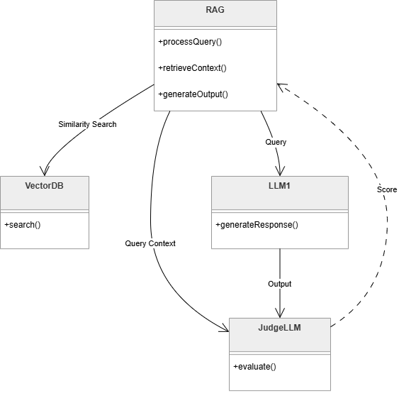

# Rapport — TP4 : Système RAG (Retrieval-Augmented Generation)

**Module :** Système Distribué Agentique  
**Formation :** Master Intelligence Artificielle & Digital Computing (S3) — FST, Université Moulay Slimane  
**Année universitaire :** 2026–2027  
**Enseignant :** Lhoussaine Daoudi  
**Étudiant :** ELAALGI Hatim  
**Sujet :** notebook *rag.ipynb* — TP4 « Application RAG »  
**Environnement :** Python 3.14, LangChain, Chroma, FastEmbed, langchain-groq, dans un conteneur Docker (voir le [rapport du TP0](../TP0_installation/README.md))

---

## 1. Objectifs

Mettre en place et évaluer une architecture **RAG**, qui permet à un LLM de répondre à partir d'un document externe qu'il ne connaît pas :
1. chargement et découpage du document en *chunks* ;
2. vectorisation des chunks et stockage dans une base vectorielle ;
3. recherche des chunks les plus proches d'une question (*retrieval*) ;
4. génération de la réponse à partir de ce contexte, puis évaluation de sa fidélité par un **LLM juge**.

Comme le propose l'énoncé, le document utilisé est **mon CV** (`pdfs/CV_ELAALGI_Hatim_2026_FR_Global.pdf`, 2 pages), à la place de la note de conjoncture de la DEPF.

## 2. Architecture et choix techniques

| Étape | Notebook de l'enseignant | Ma réalisation |
|---|---|---|
| Chargement | `PyPDFLoader` | identique |
| Découpage | `RecursiveCharacterTextSplitter`, encodeur `o200k_base`, 300 tokens, chevauchement de 20 | identique |
| Embeddings | OpenAI `text-embedding-3-small` | FastEmbed local `paraphrase-multilingual-MiniLM-L12-v2` (384 dimensions, multilingue) |
| Base vectorielle | Chroma, `./store` | identique |
| Retriever | similarité, k = 5 | identique, après correction du paramètre (section 6) |
| LLM du RAG | OpenAI `gpt-4o-mini` | Groq `qwen/qwen3.8-27b` |
| LLM juge | OpenAI `gpt-4o`, plus puissant que le LLM du RAG | Groq `openai/gpt-oss-120b` (120 milliards de paramètres, contre 27 pour le RAG) |

Groq ne fournit pas de modèle d'embedding : les vecteurs sont calculés localement, dans le conteneur. Le modèle choisi est multilingue, car le CV est en français.

Le **prompt** reprend celui de l'enseignant, avec la description du document adaptée : *« The context is about the CV (resume) of ELAALGI Hatim… If the answer is not found in the context, answer: Je ne sais pas! »*. Le juge utilise le prompt de *groundedness* de l'enseignant (note de 1 à 5 : la réponse est-elle dérivée uniquement du contexte ?).

## 3. Démarche

1. Indexation du CV, puis vérification du nombre et de la taille des chunks.
2. Test du retriever, du prompt et de la fonction `RAG()` sur les questions de l'énoncé et sur des questions sur le CV.
3. Évaluation d'une réponse par le LLM juge (fonction `evaluate()` de l'enseignant).
4. **Évaluation sur un jeu de 9 questions** dont je connais la réponse :
   - 7 dont la réponse est dans le CV ;
   - 1 absente du CV ;
   - 1 hors sujet (la question de l'enseignant sur la capitalisation boursière).

   Pour chacune, je mesure si le chunk utile a été retrouvé, si la réponse est exacte, et la note du juge.
5. **Diagnostic du retrieval** : le rang du chunk qui contient la réponse, pour différentes valeurs de k.

## 4. Résultats

### 4.1 Indexation
- Le CV donne **12 chunks**, de 257 à 291 tokens, sauf un chunk de 33 tokens en fin de page 1.
- Test des embeddings : la question « Quelles langues parle-t-il ? » a une similarité de **0.48** avec la phrase sur les langues, contre **0.06** avec une phrase sur Kafka et **0.16** avec une recette de couscous.

### 4.2 Évaluation sur 9 questions

| Question | Bon chunk dans le top 5 | Réponse du RAG | Exacte | Fidélité (juge) |
|---|---|---|---|---|
| Master et date du diplôme | oui | Master IA & Digital Computing, juin 2027 | oui | 5/5 |
| Entreprise et projet actuels | oui | Synertic, copilote d'investigation de sécurité à base d'agents LLM | oui | 5/5 |
| PFE de Licence | oui | Chatbot ATLAS | oui | **1/5** |
| Résultats du VAE (détection de fraude) | oui | AUC-PR 0,1139 contre 0,0497 (+129 %), rappel 44,2 %, coût −24 % | oui | 5/5 |
| Nombre de clients de NIDS-FL | **non** | « Je ne sais pas ! » | non (3 clients) | 1/5 |
| Langues et niveaux | oui | arabe (maternelle), français (courant), anglais (intermédiaire) | oui | 5/5 |
| Technologie de l'avatar 3D (Ibn Battuta) | oui | Three.js | oui | 5/5 |
| Date de naissance (absente du CV) | — | « Je ne sais pas ! » | oui | 5/5 |
| Capitalisation boursière (hors sujet) | — | « Je ne sais pas ! » | oui | 2/5 |

### 4.3 Diagnostic du retrieval

| k (chunks donnés au LLM) | questions dont le chunk utile est retrouvé |
|---|---|
| 1 | 2 / 7 |
| 3 | 4 / 7 |
| 4 (comportement réel du code de l'enseignant) | 6 / 7 |
| 5 | 6 / 7 |
| 12 (tout le CV) | 7 / 7 |

Le rang réciproque moyen (MRR) vaut 0.52. Pour NIDS-FL, le chunk utile n'arrive qu'au **rang 7**.

## 5. Analyse

1. **Quand le bon chunk est retrouvé, la réponse est juste.** Les 6 questions concernées reçoivent une réponse exacte et complète ; les chiffres du VAE sont recopiés sans erreur.
2. **Aucune hallucination.** Pour la question absente et pour la question hors sujet, le modèle répond « Je ne sais pas ! », grâce à la consigne du prompt.
3. **Le seul échec vient du retrieval, pas du LLM.** PyPDF n'extrait pas le texte dans l'ordre visuel du CV : le titre « NIDS-FL » se trouve à la fin du chunk 1, alors que la description « FedAvg sur 3 clients » est dans le chunk 5, sans le nom du projet. Ce chunk ne ressemble donc pas à la question, et le LLM ne voit jamais l'information.
4. **Le LLM juge n'est pas fiable sur deux points.**
   - **Faux négatif :** il donne 1/5 à « Chatbot ATLAS », une réponse exacte et présente dans le contexte, car il ne relie pas le titre du projet à la ligne « Projet de fin d'études de Licence ».
   - **Notation incohérente :** la même réponse « Je ne sais pas ! » obtient 5/5, 2/5 et 1/5 selon la question. La métrique ne précise pas comment noter une abstention.

   Le juge mesure par ailleurs la **fidélité au contexte**, pas l'**exactitude** de la réponse.

## 6. Difficultés et corrections

| Problème | Solution |
|---|---|
| **Bug du notebook de l'enseignant** : `search_Kwargs={'k',5}` (K majuscule, et un ensemble au lieu d'un dictionnaire) est ignoré ; le retriever renvoie 4 chunks au lieu de 5 | `search_kwargs={'k': 5}` ; la correction est vérifiée dans le notebook (4 chunks, puis 5) |
| Groq ne propose pas de modèle d'embedding | embeddings calculés localement avec FastEmbed (modèles ONNX, sans PyTorch) |
| Le téléchargement du modèle d'embedding échoue dans le conteneur (protocole Xet de Hugging Face) | `HF_HUB_DISABLE_XET=1` dans `compose.yaml` ; choix d'un modèle léger (0,2 Go) plutôt que d'un modèle de 1 Go, pour limiter le temps de téléchargement |
| PyPDF sépare les mots par des **tabulations** (`Digital\tComputing`) : la recherche du mot-clé de la réponse échouait | normalisation des espaces avant la comparaison |
| La fonction `evaluate()` rappelle `RAG()` : le juge pourrait noter une autre réponse que celle affichée | dans l'évaluation sur 9 questions, `juger()` reçoit exactement la réponse affichée et le contexte qui a servi à la produire |
| Une nouvelle exécution du notebook ajouterait les mêmes chunks en double dans la collection Chroma | la base `./store` est vidée avant l'indexation |

## 7. Conclusion

Le pipeline RAG de l'enseignant fonctionne sur mon CV. Il répond juste à 6 des 7 questions dont la réponse est dans le document, et n'invente rien pour les 2 questions sans réponse. L'expérience montre que la qualité d'un RAG dépend d'abord du **retrieval**, et le retrieval de la **préparation du document**. Pour un CV, il faudrait nettoyer le texte extrait et découper **par section ou par projet** plutôt qu'à taille fixe, afin que chaque chunk contienne un titre et sa description. Enfin, un LLM juge permet d'automatiser l'évaluation, mais il doit lui-même être vérifié : sa métrique doit préciser comment noter une abstention, et une mesure d'exactitude doit la compléter.
